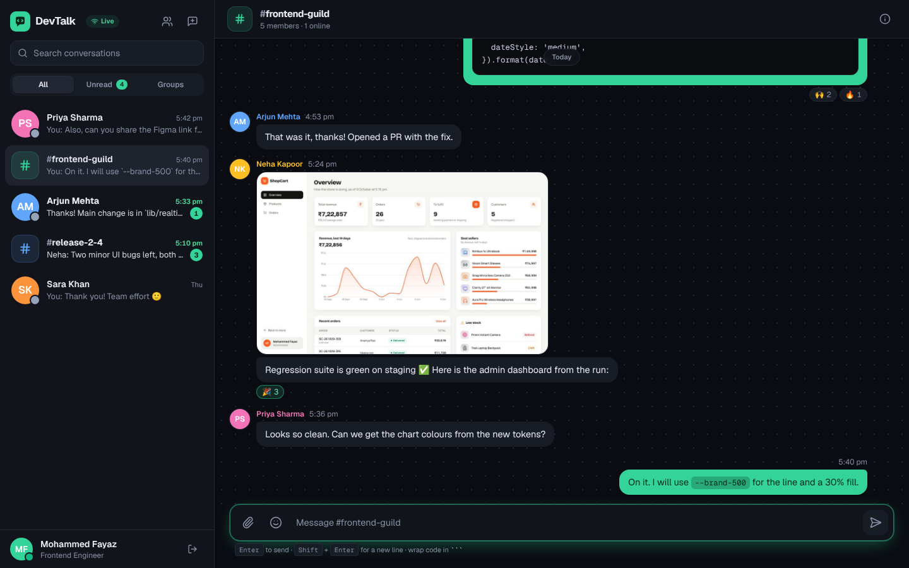
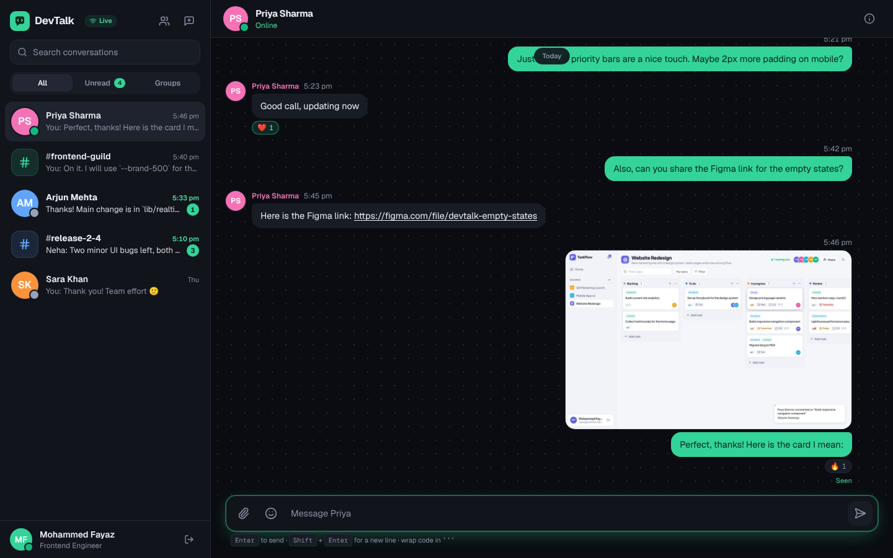
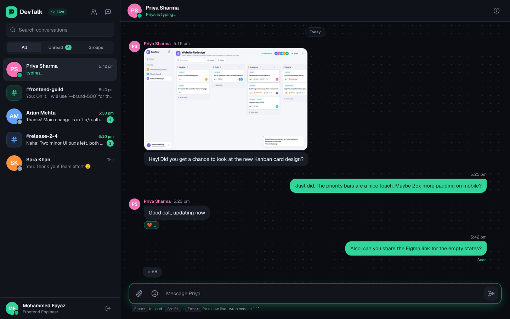
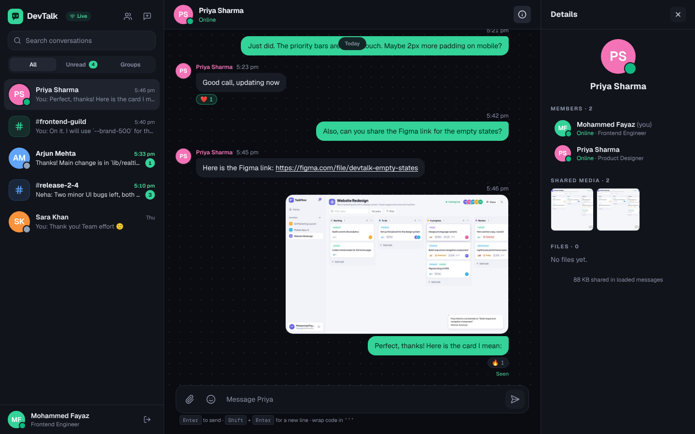
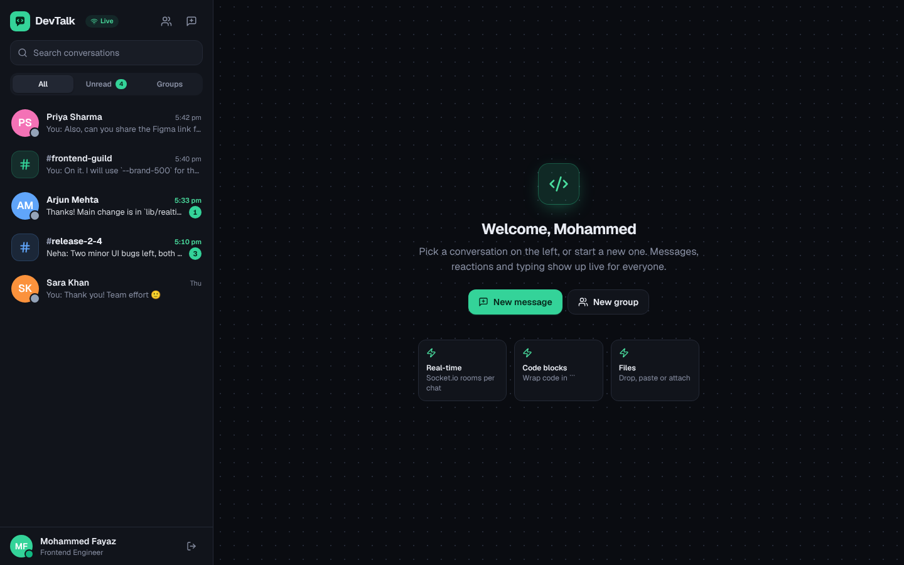
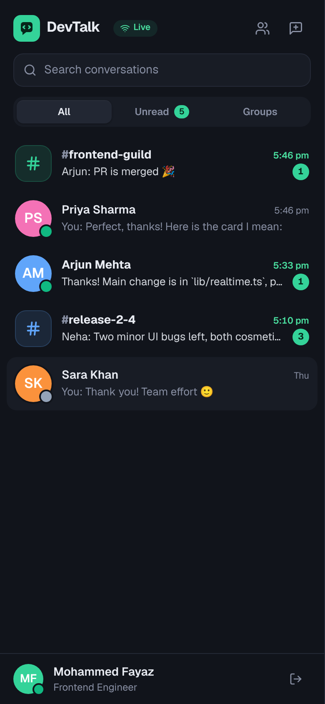
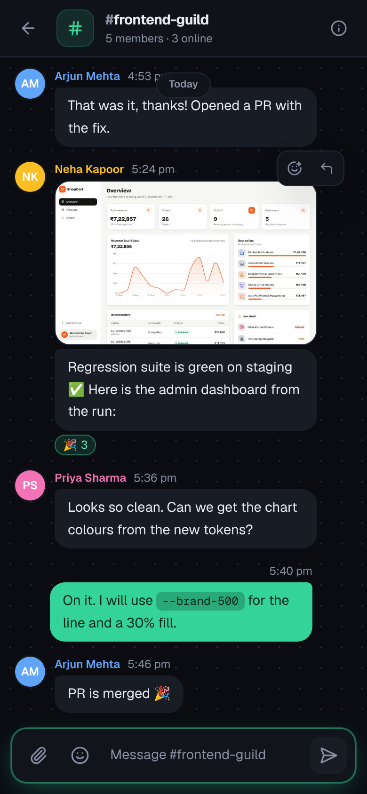

<div align="center">

# 💬 DevTalk

**Real-time chat for engineering teams** — direct messages and group channels with file sharing, code blocks, reactions, typing indicators, read receipts and online presence.




</div>

## Features

**Messaging**
- One-to-one direct messages and group channels (`#frontend-guild`) with admins
- Code blocks with a language label and a copy button, inline `code`, **bold** and auto-linked URLs
- Image and file sharing by button, drag and drop, or paste (up to 10 MB each), with an in-app image viewer
- Replies, emoji reactions, edit and delete (for everyone)
- Infinite scroll back through history with cursor pagination

**Real-time (Socket.io)**
- Messages, edits, reactions and new conversations arrive instantly
- Typing indicators ("Priya is typing…")
- Online presence and "last seen", shared only with people you have a conversation with
- Read receipts ("Seen") in direct messages and live unread counts in the sidebar

**Engineering**
- TypeScript end to end, strict mode
- Socket rooms per conversation and per user, authenticated with the same JWT as the REST API
- Optimistic sending with server reconciliation; messages are de-duplicated between the HTTP response and the socket event
- File uploads validated by type and size; swap the disk storage for S3 or Cloudinary without changing the API
- Integration tests (Vitest + Supertest) for access control, unread counts, pagination, edit permissions, reactions and uploads
- GitHub Actions CI

## Screenshots

| Direct message | Typing indicator |
| --- | --- |
|  |  |
| **Conversation details** | **Home** |
|  |  |

<p align="center"> </p>

## Tech stack

| Layer | Tools |
| --- | --- |
| Frontend | React 18, TypeScript, Vite, TanStack Query (infinite queries), Socket.io client, React Router, Tailwind CSS, Framer Motion |
| Backend | Node.js, Express, Socket.io, Mongoose, Multer, Zod, JSON Web Tokens, bcrypt |
| Database | MongoDB |
| Testing & CI | Vitest, Supertest, GitHub Actions |

## Getting started

**Requirements:** Node.js 20+ and MongoDB (local, Docker or Atlas).

```bash
git clone https://github.com/mdfayaz25/devtalk.git
cd devtalk
npm install

docker compose up -d                 # or point MONGO_URI at Atlas
cp server/.env.example server/.env
npm run seed                         # 6 people, 2 groups, 3 DMs with code, images and files
npm run dev                          # API + sockets on :5000, app on :5173
```

Sign in with any demo account (password `Demo@1234`): `fayaz@devtalk.dev`, `priya@devtalk.dev`, `arjun@devtalk.dev`, `neha@devtalk.dev`, `karthik@devtalk.dev`, `sara@devtalk.dev`.

> **Try it live:** open two windows (one private), sign in as Fayaz and Priya, open their DM and start typing.

### Scripts

| Command | What it does |
| --- | --- |
| `npm run dev` | Runs the API and the React app together |
| `npm run seed` | Resets the database and copies sample attachments into `server/uploads` |
| `npm test` | Runs the API integration tests |
| `npm run typecheck` | Type-checks server and client |
| `npm run build` then `npm start` | Production build; Express serves the React app and uploads |

## Socket events

| Event | Direction | Payload |
| --- | --- | --- |
| `message:new`, `message:updated` | server → room `conv:<id>` | Full message |
| `conversation:updated` | server → `user:<id>` | Conversation with that user's unread count |
| `typing` | both | `{ conversationId, userId, isTyping }` |
| `read` | server → room | `{ conversationId, userId, at }` |
| `presence`, `presence:list` | server → rooms | `{ userId, online, lastSeen }` |

## API overview

| Method | Endpoint | Notes |
| --- | --- | --- |
| `GET` | `/api/conversations` | Your conversations with unread counts |
| `POST` | `/api/conversations/direct` | Finds or creates the DM for a pair |
| `POST` | `/api/conversations/group` | Creator becomes admin |
| `GET` `POST` | `/api/conversations/:id/messages?before=<id>` | Cursor pagination |
| `POST` | `/api/conversations/:id/read` | Updates read receipt |
| `POST` `DELETE` | `/api/conversations/:id/members[/:userId]` | Admins add/remove; anyone can leave |
| `PATCH` `DELETE` | `/api/messages/:id` | Sender only |
| `POST` | `/api/messages/:id/reactions` | Toggles an emoji |
| `POST` | `/api/uploads` | `multipart/form-data`, field `files` |
| `GET` | `/api/users?search=` | People search for new chats |

## License

MIT © [Mohammed Fayaz](https://github.com/mdfayaz25)
